# Pokemon Bank and Poke Mover Offline Patch

[GitHub](https://github.com/Wokann/bank_and_mover_offline_patch) · [简体中文](README.zh-cn.md) · [Download](../../releases/latest) · [Changelog](CHANGELOG.md)

Use Pokemon Bank and Poke Mover locally and offline on Nintendo 3DS, even after the official servers shut down.

## AI usage statement

This project uses AI tools, including OpenAI Codex, to help analyze decompiled output, design patches, write code, and review changes. If you have concerns about using patches developed with AI-assisted reverse-engineering analysis or coding, please take this into account before deciding whether to use them.

## Features

### Bank

1. Offline mode: Manage a local Bank with the original features, including Pokemon deposits and withdrawals, box organization, Poke Miles, Pokedex records, and game information.
2. Download mode: Download your official Bank for offline use while the official servers are available. Local data cannot be uploaded back to the official server.
3. Unlock mode: Unlock an official Bank that has become unusable because of mismatched save data, while the official servers are available.
4. Original mode: Use Bank's original online features while the official servers are available.
5. Mode selection: Press **R** on the title screen to switch modes.
6. Language selection: Press **L** on the title screen to change the interface language.
7. Multiple users: Configure multiple local accounts, each with its own settings.
8. Mystery Gifts: Receive gifts when they are enabled in the configuration and the console date and selected game meet the distribution requirements.
9. Virtual shop: Set the console date within the configured period to try virtual top-ups, claim a 30-day trial pass, and buy 365-day annual passes. Virtual funds are for local simulation only and are unrelated to eShop funds or money in any real account.

### Mover/Transporter

1. Offline mode: Transfer Pokemon from supported `Gen5` and `VC Gen1/2` saves into the local Bank's Transport Box.
2. Online mode: Use Mover's original online features while the official servers are available.
3. Mode selection: Press **R** on the title screen to switch modes.
4. Multiple users: Configure multiple local accounts, each with its own settings.
5. Gen5 digital support: Recognize legally dumped Gen5 cartridge ROMs and saves stored in the specified SD card locations, in both Offline and Online modes.
6. Screening by the fake server: In addition to the original client checks, the offline patch includes some name and Pokemon screening rules documented by the community to simulate the official server's checks. These do not completely reproduce the official rules. You can disable these extra filters in the configuration.
7. Custom options: Enable selected v1.2 conversion rules for an account (VC Gen1 only; VC Gen2 continues to use v1.5 rules), or enable Chinese encoding conversion for VC fan translations and preserve Chinese names from Gen5. These options are disabled by default and must be enabled manually. See the [personal configuration guide](configTemplate/templateForCopy/Bank/fakeServers/users/readme_user.md) for their scope and limitations.

Notes:

1. Bank and Mover share the same Bank data for a given account. Each account has its own separate Bank data.
2. Local Bank data in Offline Mode is independent of the official server's Bank data. Official data can be downloaded to replace local data, but local data cannot be uploaded back to the official server.
3. To move Pokemon from Offline Mode to Original Mode, use a Gen6/7 game as an intermediate step: Offline Mode → Gen6/7 → Original Mode.

## Installation

Back up your Bank data and game saves before proceeding. Update the Bank and Mover patches together.

### 1. Install and enable the patches

#### Installation

Download the [latest release](../../releases/latest).<br>
On a 3DS with Luma3DS, copy the required complete Title ID folders to `SD:/luma/titles/`:

| Application | Patch directory |
| --- | --- |
| Pokemon Bank | `SD:/luma/titles/00040000000C9B00/` |
| Poke Mover | `SD:/luma/titles/00040000000C9C00/` |

Notes:

1. Remove the old patch directory completely before copying the replacement.
2. Use the supported v1.5 base applications; the title screen shows v1.5 at the lower left of the upper screen. If older official updates are installed, uninstall the update data for `0004000E000C9B00` and `0004000E000C9C00` to avoid conflicts with the offline patches.
3. If `SD:/luma/titles/` does not exist, create it manually.

#### Enabling

Hold `SELECT` while powering on, enable `Enable game patching` in the Luma configuration, then save and reboot.


### 2. Install the configuration pack (optional, but recommended)

Copy the included `Bank` folder to `SD:/3ds/`. The main directories are shown below; see [SD layout and file protection](configTemplate/templateForCopy/Bank/readme_fakeServer.md) for the complete file descriptions.

```text
SD:/3ds/Bank/
├── client/
│   └── client.conf
└── fakeServers/
    └── shared/
        ├── server.conf
        ├── gifts/
        └── mover/
```

Notes:

1. If you do not copy the configuration pack, the patch can still generate the basic default configuration automatically.
2. `Bank/fakeServers/shared/gifts/` and `Bank/fakeServers/shared/mover/` contain additional data that the patch does not generate automatically. They provide Bank gift distributions and rules that simulate Mover's server checks, including word lists and Pokemon screening rules. Omitting these does not affect basic offline Bank functionality, but gift distributions and those extra server checks will be unavailable.
3. If `SD:/3ds/` does not exist, create it manually.

### 3. Updating older versions

1. When upgrading from the directory layout used by v0.9.1 or earlier, close Bank and Mover first. Back up the entire `SD:/3ds/Bank/` directory and the relevant game saves elsewhere, including any `.bak` and `.tmp` files.
2. When Bank first creates an account, if neither `client/users/` nor `fakeServers/users/` contains any user directories, it migrates the existing `bankdata` and `sav` files with `.bin`, `.bak` and `.tmp` extensions from the old root directory to the corresponding directories for the first selected account. Successfully migrated files are moved out of their old locations.
3. If either side already contains any user directory, including another account or an empty directory, automatic migration will not run. Migration also will not overwrite any of the six destination files if one already exists. In these cases, manually migrate the files to the account you want to use.
4. If you already have v1.0.0 user directories, a normal update usually requires replacing only the two complete patch directories. You do not need to copy the configuration pack to `SD:/3ds/Bank/` again. Follow the accompanying instructions if a later update requires other changes.

**Azahar emulator:** Put the patch folders under the emulator user directory's `load/mods/`, not on its virtual SD card. Put the same Bank configuration folder under `sdmc/3ds/Bank/` in that user directory.

## Basic usage

### Initializing an account

1. After installing the patches and configuration pack, start **Bank** first. The patch creates a default account based on the console account or user name. In Offline and Download modes, the title screen shows account information (`nnid_xxx`/`pnid_xxx`/`localid_xxx`) at the upper left of the lower screen. Use Up/Down to switch when multiple users are available.
2. To create a new local Bank, select `Offline Mode` and prepare at least one compatible Gen6/7 game with a valid save. Select the game to create or migrate the Bank. Without a usable game save, Offline Mode will not open the main menu.
3. To keep an existing official Bank, you can first use `Download Mode` to import it into the target local account; there is no need to create an empty local Bank beforehand.
4. If your official Bank is locked because of mismatched save data, you can first use `Unlock Mode` to clear the lock, then use `Download Mode`.
5. Before **Mover Offline Mode** can transfer to a local account, **Bank** must create, migrate or download the local Bank data for that account.

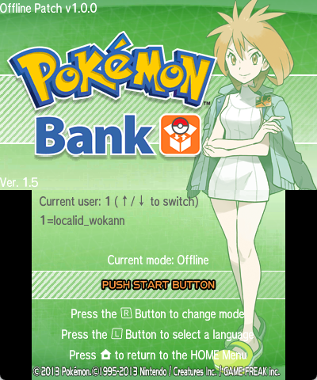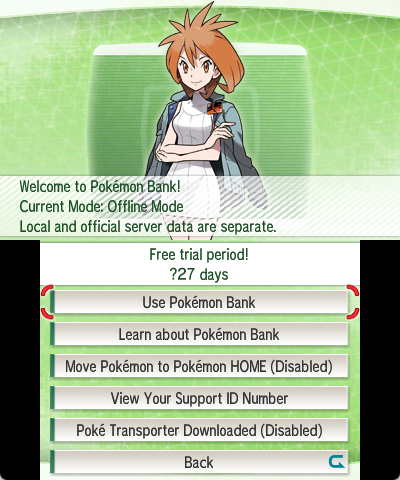

### Using Bank

#### Offline Mode

1. Press **R** on the title screen to switch modes.
2. `Offline Mode` provides the original basic features with additional explanatory messages. Transfers to Pokemon HOME and links to the eShop are disabled.

#### Download Mode

1. Press **R** on the title screen to switch modes.
2. Select `Download Mode`, choose the target local account on the title screen, then download your official Bank data. That account's existing local Bank will be overwritten. Back up the existing `bankdata.bin` beforehand if needed.
3. Download Mode does not require a compatible game save. If no usable game is available, you can confirm a direct download; the application returns to the title screen when it finishes.

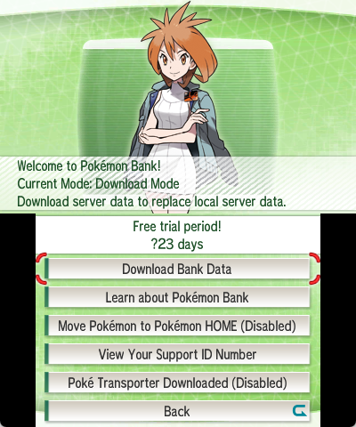

#### Unlock Mode

1. Press **R** on the title screen to switch modes.

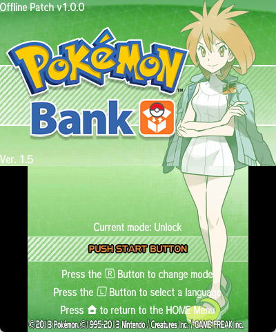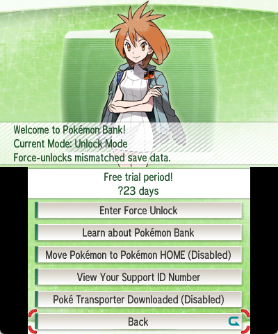

2. What does `Unlock Mode` unlock?

If a Bank session is interrupted while saving and exiting, the server may not finish processing the transaction. On the next visit, Bank asks you to reconnect using the same game and save so it can complete the unfinished process.<br>
If the original save is lost, replaced, or changed by further play or other saves so that it no longer matches the interrupted transaction, Bank may be unable to complete normal recovery for that account.

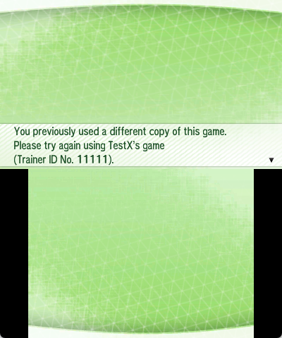<br>
In the original workflow, players whose Bank is locked and who cannot recover the corresponding save would contact Customer Support for instructions on opening the unlock screen. They would provide the reference number, then enter the unlock code supplied by support.<br>
Unlock Mode displays the required key combination and the matching unlock code on the entry screen, allowing players to unlock the account without contacting support.

**Forcing an unlock may cause Pokemon from your last unfinished transfer to be lost. First confirm that none of your game saves matches the official server, then hold L + A + START while selecting and confirming a game to enter the forced unlock screen.**

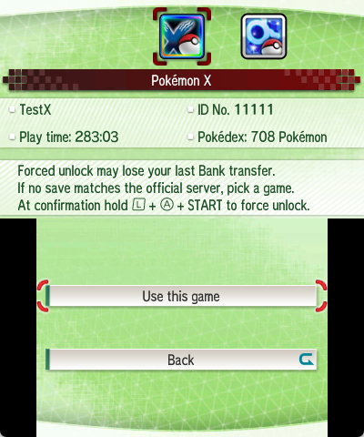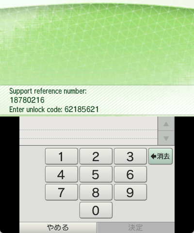

#### Original Mode

1. Press **R** on the title screen to switch modes.
2. `Original Mode` follows the original official online workflow and is independent of local Bank data.

### Using Mover

#### Offline Mode

1. Press **R** on the title screen to switch modes.
2. `Offline Mode` provides the original basic features, with added support for Gen5 digital sources.

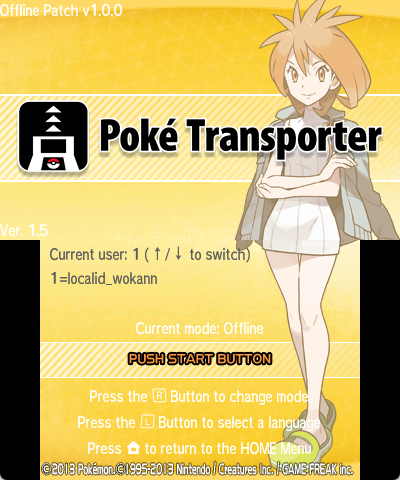

#### Online Mode

1. Press **R** on the title screen to switch modes.
2. `Online Mode` follows the original official online workflow and is independent of local Bank data, with added support for Gen5 digital sources.

#### Gen5 digital support

1. This implementation uses zaksabeast's [Transporter Redirect Patch](https://github.com/zaksabeast/DreamRadarCartRedirect) as a reference and extends its functionality.
2. Only Black, White, Black 2 and White 2 are supported. Place legally dumped `*.nds` ROMs in `SD:/roms/nds/` and matching `*.sav` files with the same base names in `SD:/roms/nds/saves/`. Saves do not need a fixed filename.
3. The game list can show saves for all four Gen5 games at once.

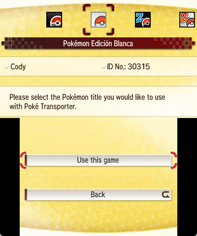

4. If both a cartridge and an SD copy of the same game are available, the cartridge takes priority.
5. If multiple language versions of the same game are available, priority is `J > O > F > I > D > S > K` (Japanese > English > French > Italian > German > Spanish > Korean).
6. If multiple copies of the same game and language are available, the first copy found with a valid save takes priority.

See [Bank usage](bank/README.md) and [Mover usage](mover/README.md) for more details.

## Advanced usage

### Architecture of the offline patch

- In Offline Mode, the patch uses a simple local fake server to respond to the data and requests that Bank and Mover would normally send to the official server, without making network connections. Its architecture is a custom community implementation and does not represent the official server's actual design.
- The relevant configuration and files on the SD card are organized as follows:

```text
sd:/3ds/Bank/
├── client/
│   ├── client.conf|bak|tmp
│   ├── log/
│   └── users/
│       └── <userID>/
│           └── sav.bin|bak|tmp
└── fakeServers/
    ├── shared/
    │   ├── server.conf|bak|tmp
    │   ├── gifts/
    │   │   ├── gift.conf
    │   │   ├── 01_celebi/
    │   │   ├── 02_johto_starters/
    │   │   ├── 03_regi_trio/
    │   │   ├── 04_mewnium_z/
    │   │   ├── 05_alola_starters/
    │   │   └── 06_ha_apes/
    │   └── mover/
    │       ├── nds/
    │       │   ├── checkPokemon.conf
    │       │   └── checkName.conf
    │       └── vc/
    │           ├── checkPokemon.conf
    │           └── checkName.conf
    └── users/
        └── <userID>/
            ├── user.conf|bak|tmp
            ├── bankdata.bin|bak|tmp
            └── transaction.bin|bak|tmp
```

- `client`: Records local client account information and the corresponding `sav.bin`. This is not the Bank data that stores Pokemon; it records data used in interactions with the server and redirects Bank's original `turtle` save data.
- `fakeServers`: Contains the fake server's shared configuration and individual account data. Shared configuration includes free-use periods, gift contents and distribution windows, and Mover screening rules. Each account has its own core Bank data, locale, balance and pass settings.

### Creating a new account

- As described under Basic usage, Bank defaults to `auto` on first use. This mode creates the initial account from the console information. Account entries are stored in `sd:/3ds/Bank/client/client.conf`.

```ini
[global]
activeUser=auto;

[users]
1=nnid_test1;
```

You can manually add account names in order under `[users]`. Names must follow the `nnid_xxx`/`pnid_xxx`/`localid_xxx` format; the suffix can be customized.<br>
You can also copy the entire `3ds/Bank` folder to another console. In `auto` mode, the patch creates an account based on the current environment: the official NNID account, a Pretendo account, or the emulator's user name.

```ini
[global]
activeUser=2;

[users]
1=nnid_test1;
2=pnid_test2;
3=localid_test3;
```

After adding an account, you do not need to create its folders manually. Open Bank, select the account with Up/Down on the title screen, and use it; the corresponding folders will be created. When switching accounts, the `auto` option always refers to the current console's default account.

- The configuration pack includes more detailed README files; refer to them for further information.

### Free use, trial passes and virtual funds

- These settings are stored in `sd:/3ds/Bank/fakeServers/shared/server.conf`. The file and default values are generated even if you have not copied the configuration pack.
- The configuration records the official free-use periods and trial-pass offer periods, annual pass prices for each eShop region, and the amount added by each virtual top-up. By default, one top-up adds the price of one annual pass in the corresponding currency.
- To claim a trial pass, set the console date within the configured offer period and use an account that has not created Bank data, claimed a trial pass or purchased an annual pass. An account that has already created Bank data cannot trigger the trial-pass offer merely by setting the date back to the offer period.
- You can enable or disable free use and trial offers, change their date ranges, and adjust virtual annual pass prices. These are local simulations and have no connection to real money.
- Each account's virtual balance, pass validity and related information are stored in its own `sd:/3ds/Bank/fakeServers/users/<userID>/user.conf`.

```ini
[ticket]
free_enable=true;
free_periods=2020-02-12..2020-03-12,2023-02-14..2050-12-31;

trial_enable=true;
trial_periods=2013-12-25..2014-02-21;
trial_periods.JPN=2013-12-25..2014-02-21;
trial_periods.USA=2014-02-05..2014-03-14;
……

# shop.$<currency>=<annual_price>,<recharge>; non-negative integers. Balances are in user.conf.
# $NONE uses the custom value 807, the highest Pokedex number supported by Bank.
shop.$NONE=807,807;
shop.$JPY=500,500;
shop.$USD=499,499;
……
```

- The configuration pack includes more detailed README files; refer to them for further information.

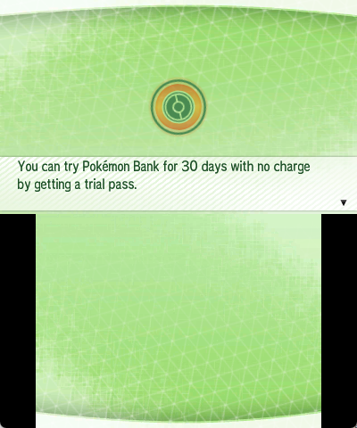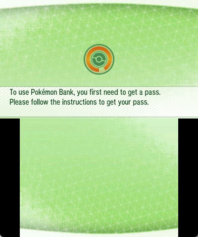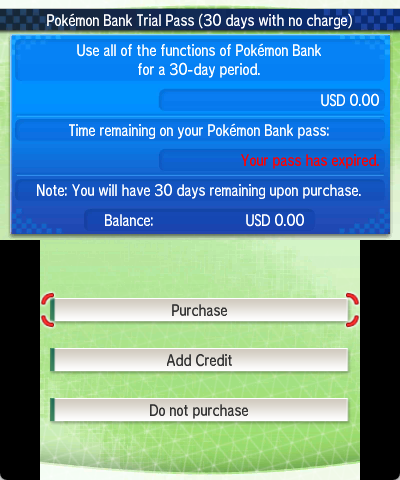

### Mystery Gifts

- Copy the included configuration pack to the specified location on the SD card to use this feature.
- `sd:/3ds/Bank/fakeServers/shared/gifts/gift.conf` lists the six existing Bank gift distributions, their data paths and their distribution windows. The default dates follow the historical official distributions. You can enable or disable individual gifts and change their date ranges.
- Custom gifts are supported. Place gift data such as WC6, PL6 and WC7 files according to the template, then configure their distribution.

```ini
[global]
enableGift=true;

[gift.01_celebi]
enabled=1;
id=1;
generation=6;
games=XY;
periods=2013-12-25..2014-09-30;
periods.USA=2014-02-05..2014-09-30;
periods.EUR=2014-02-04..2014-09-30;
periods.AUS=2014-02-04..2014-09-30;
file=gifts/01_celebi/celebi.pl6;
```

- The configuration pack includes more detailed README files; refer to them for further information.

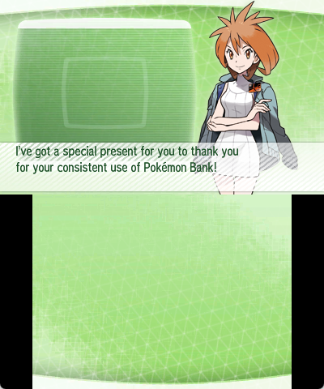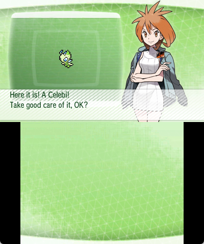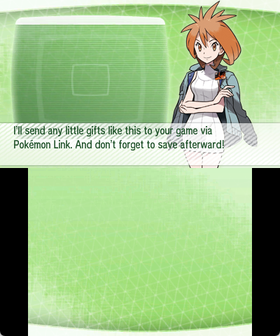

### Mover screening

- Copy the included configuration pack to the specified location on the SD card to use this feature.
- `sd:/3ds/Bank/fakeServers/shared/mover/` has separate `nds` and `vc` directories, each containing `checkPokemon.conf` and `checkName.conf`.
- `checkPokemon.conf` defines which Pokemon are allowed or rejected when particular conditions are met. The included rules are based on findings documented by the community and do not completely reproduce the official server's actual rules.

```ini
[global]
enableCheckPokemon=true;

[rule.151_mew_ot_tid22796]
enabled=1;
action=require;
condition=
    species == 151 &&
    tid == 22796 &&
    (ot == "GF" || ot == "ゲーフリ");
```

- `checkName.conf` stores the bad-word list. Since the official server's rules are unavailable, this feature uses NGWord version 18 from Nintendo 3DS system version 11.1.0-34, the final NGWord version on 3DS.
- As with gifts, you can add or remove entries in the configuration, or disable the relevant screening globally at the beginning of the file.

```ini
[global]
enableCheckName=true;

[allow_nickname]

[allow_ot]

[ngword]
……
```

- The configuration pack includes more detailed README files; refer to them for further information.

### Account configuration

- Each account has a core configuration at `sd:/3ds/Bank/fakeServers/users/<userID>/user.conf`, storing its locale, pass validity, virtual balances and related information.
- Pass validity and virtual balances correspond to the Free use, trial passes and virtual funds section above.
- Locale values are taken from the console when the account is created. After the initial setup, they are not automatically changed.
- Locale settings have little effect on using Bank but matter more for VC transfers through Mover. In the original application, transferring Pokemon from VC to Bank through Mover writes the console's region information into them. Since VC titles were not sold across eShop regions, installing a dumped US VC title on a Japanese console and transferring from it will result in abnormal region information and cause the Pokemon to be flagged as illegal.
- You can manually change an account's locale values to match the appropriate region for the VC game you want to transfer from.
- `sd:/3ds/Bank/fakeServers/users/readme_user.md` includes the full list of locale combinations to help you select suitable values.

```ini
[console]
autoRegion=false;
region=0;
language=0;
country=1;
state=0;

[ticket]
purchased=false;
paid_periods=0000-00-00..0000-00-00;
trial_claimed=false;
annual_count=0;

autoCurrency=true;
currentCurrency=$JPY;
balance.$NONE=0;
balance.$JPY=0;
balance.$USD=0;
……
```

- The configuration pack includes more detailed README files; refer to them for further information.

## Configuration and documentation

- [SD layout and file protection](configTemplate/templateForCopy/Bank/readme_fakeServer.md)
- [User selection and migration](configTemplate/templateForCopy/Bank/client/readme_client.md)
- [Server policy and diagnostic logging](configTemplate/templateForCopy/Bank/fakeServers/shared/readme_server.md)
- [Personal locale, currency and passes](configTemplate/templateForCopy/Bank/fakeServers/users/readme_user.md)
- [Gifts](configTemplate/templateForCopy/Bank/fakeServers/shared/gifts/readme_gift.md)
- [Pokemon screening and rule sources](configTemplate/templateForCopy/Bank/fakeServers/shared/mover/readme_checkPokemon.md)
- [Name filtering, exceptions and sources](configTemplate/templateForCopy/Bank/fakeServers/shared/mover/readme_checkName.md)
- [Bank data viewer](ViewerForBankdata/README.md)

## Building from source

Build with GNU Make, Python 3, devkitARM, armips and Floating IPS.<br>
Original decrypted/decompressed code, ExHeader and RomFS inputs must come from your own legally obtained titles and are not distributed in this repository.

Run `make` from the repository root to build and verify Bank and Mover, with output in `release/`. You can also build them separately with `make -C bank` and `make -C mover`.

- [Bank build instructions and implementation](bank/README.md#independent-build)
- [Mover build instructions and implementation](mover/README.md#independent-build)
- [Shared service and storage](common/README.md)

## License

This project is licensed under the GNU General Public License, version 3 or any later version (`GPL-3.0-or-later`). See [LICENSE](LICENSE).

Third-party code, tools, data and assets retain their respective licenses and copyright notices; see the corresponding files and documentation. This project's license does not replace or extend third-party permissions.

## Acknowledgements

Thanks to the following projects for their tools, data and public implementation references:

- [Luma3DS](https://github.com/LumaTeam/Luma3DS): References for patch loading on real hardware, LayeredFS, BPS and console locale overrides.
- [devkitPro / devkitARM](https://github.com/devkitPro/buildscripts), [armips](https://github.com/Kingcom/armips) and [Floating IPS](https://github.com/Sir-Walrus/Flips): Compiler toolchain, assembly and BPS patch generation.
- [GodMode9](https://github.com/d0k3/GodMode9): Extracting application data.
- [DreamRadarCartRedirect](https://github.com/zaksabeast/DreamRadarCartRedirect): Reference for redirecting NDS cartridge saves to the SD card.
- [libctru](https://github.com/devkitPro/libctru) and [citro3d](https://github.com/devkitPro/citro3d): References for 3DS system services, font structures and texture formats.
- [Azahar](https://github.com/azahar-emu/azahar) and [Nimbus](https://github.com/PretendoNetwork/nimbus): References for emulator loading, system interfaces and identifying Nintendo/Pretendo service environments.
- [Magikoopa](https://github.com/RicBent/Magikoopa): Reference for 3DS code injection and executable image expansion.
- [3DS-Explorer / DSDecmp](https://github.com/svn2github/3DS-Explorer) and [Switch-Toolbox](https://github.com/KillzXGaming/Switch-Toolbox): References for LZ11 compression and CTR layout formats.
- [PKHeX](https://github.com/kwsch/PKHeX) and [PokeAPI](https://github.com/PokeAPI/pokeapi): References for Pokemon formats, multilingual names, language/version values and locale data.
- [EventsGallery](https://github.com/projectpokemon/EventsGallery): Gift distribution assets and records.
- [badword](https://github.com/abcboy101/badword): Nintendo 3DS bad-word data and NGWord rule information.
- [PKMN_GSCHS](https://github.com/TomJinW/PKMN_GSCHS) and [pokecrystal_cn](https://github.com/TomJinW/pokecrystal_cn): Character encoding maps for the Chinese fan translations of Korean Gold/Silver and US Crystal.
- [LumaLocaleSwitcher Reworked (Chinese translation)](https://github.com/OasisAkari/LumaLocaleSwitcher_Reworked_zh_hans): Country and state/province ID data.
- [pret/pokecrystal](https://github.com/pret/pokecrystal): Reference for Generation II Odd Egg distribution data.
- [Unicode Character Database](https://www.unicode.org/Public/17.0.0/ucd/ReadMe.txt): Unicode case mappings used by name filtering. See the [Unicode license](common/tools/LICENSE.unicode.txt).

See the relevant configuration guides for specific data sources, versions and licensing information. Each third-party project retains its own license and copyright notices.

## Unofficial-project disclaimer

This is an independently developed, unofficial patch. It is not affiliated with, sponsored by, endorsed by, or authorized by Nintendo, The Pokemon Company, Creatures Inc., or GAME FREAK inc. Original software, characters, names and assets remain the intellectual property of their respective owners. The project is intended for software preservation, technical research and interoperability.
