# Pokemon Bank 与 Poke Mover 离线补丁

[GitHub](https://github.com/Wokann/bank_and_mover_offline_patch) · [English](README.md) · [下载](../../releases/latest) · [更新记录](CHANGELOG.zh-cn.md)

让 Nintendo 3DS 上的 Pokemon Bank 和 Poke Mover 能够在官方服务器关闭的情况下，也能离线本地使用。

## AI 使用声明

本项目使用 AI 工具（包括 OpenAI Codex）辅助分析反编译结果、设计补丁、编写代码及审查修改。如果你介意使用 AI 参与反编译分析或代码开发的补丁，请在使用前了解这一点，并自行决定是否使用。

## 主要功能

### Bank

- 1、离线模式：离线管理本地银行，使用宝可梦存取、盒子整理、宝可里程、图鉴记录、游戏信息一览等原有功能。
- 2、下载模式：可在官方服务器关闭前，下载个人官方银行数据进行离线使用（无法回传官方服务器）。
- 3、解锁模式：可在官方服务器关闭前，解锁曾经因存档不匹配导致数据锁死，无法使用银行的情况。
- 4、原版模式：可在官方服务器关闭前，正常使用Bank的原版所有联网功能。
- 5、模式切换：可在标题界面按R键切换模式。
- 6、多语言切换：可在标题界面按L键切换界面语言。
- 7、多用户切换：可自定义配置多个离线本地账户，并设置相关自定义配置。
- 8、神秘礼物配信：在配置已启用、主机日期和对应游戏满足配信条件时，可以领取相应神秘礼物。
- 9、虚拟购物：将主机时间改至配置的有效时段，可以体验虚拟充值、领取30天试用券及购买365天年券等功能（虚拟金额仅为本地模拟体验，与 eShop 或任何真实账户的货币均无关联）。

### Mover/Transporter

- 1、离线模式：将受支持的 `Gen5` 及 `VC Gen1/2` 存档中的宝可梦传入本地银行的传送盒。
- 2、在线模式：可在官方服务器关闭前，正常使用Mover的所有联网功能。
- 3、模式切换：可在标题界面按R键切换模式。
- 4、多用户切换：可自定义配置多个离线本地账户，并设置相关自定义配置。
- 5、Gen5数字化兼容：离线、在线模式，均支持识别sd卡内指定位置存放的gen5卡带合法转储rom及sav。
- 6、伪服务器的合法性筛选：除了客户端原有检查，离线补丁还预置了社区已知的部分姓名和宝可梦筛选规则，用以模拟官方服务器的检查行为，但不代表完整还原了官方规则。你也可以在配置中关闭这部分附加筛选。
- 7、其他自定义配置：可为账户开启 v1.2 的部分转换规则（仅影响 VC Gen1。VC Gen2仍使用 v1.5 规则），或开启 VC 汉化编码转码及 Gen5 中文姓名保留。自定义配置默认关闭，需手动开启，具体范围和注意事项见[个人配置说明](configTemplate/templateForCopy/Bank/fakeServers/users/readme_user.zh-cn.md)。

注：<br>
1、对于同一个账户，Bank与Mover共用同一个银行数据。不同账户会有各自独立的银行数据进行存储。<br>
2、离线模式下的本地银行数据，与官方服务器的银行数据彼此独立。仅支持官方数据下载覆盖本地数据，不支持将本地数据回传官方服务器。<br>
3、如有需要将离线模式的宝可梦传至原版模式，请通过Gen 6/7游戏进行中转（离线模式->Gen 6/7->原版模式）

## 安装

操作前请备份银行数据及游戏存档；Bank 与 Mover 补丁需要一起更新。

### 1. 安装补丁并启用

#### 安装

下载[最新发行版](../../releases/latest)。<br>
使用 Luma3DS 的主机，将所需的完整 Title ID 文件夹复制到 `SD:/luma/titles/`：

| 软件 | 补丁目录 |
| --- | --- |
| Pokemon Bank | `SD:/luma/titles/00040000000C9B00/` |
| Poke Mover | `SD:/luma/titles/00040000000C9C00/` |

注：<br>
1、若存在旧补丁，请完全移除旧目录后再复制进来。<br>
2、请使用受支持的 v1.5 软件本体（标题界面上屏左下角显示为 v1.5）。若安装过旧官方更新补丁，请卸载  `0004000E000C9B00`、`0004000E000C9C00` 对应的数据，避免与离线补丁冲突。
3、若不存在`SD:/luma/titles/`文件夹，请自行手动新建文件夹。

#### 启用

按住 `SELECT` 开机，在 Luma 配置中启用 `Enable game patching`，保存并重启。

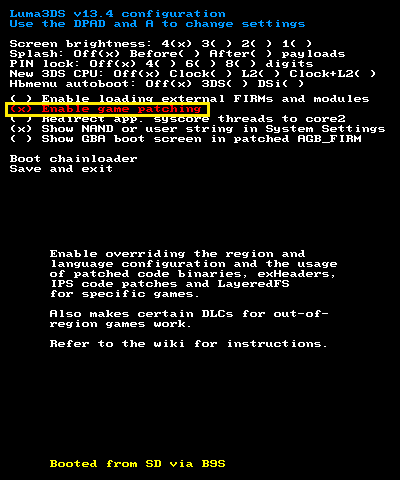


### 2. 安装配置包（可选，但推荐安装）

将补丁附带的`Bank`文件夹复制到 `SD:/3ds/`，主要目录如下；完整文件说明见 [SD 目录及文件保护](configTemplate/templateForCopy/Bank/readme_fakeServer.zh-cn.md)。

```text
SD:/3ds/Bank/
├── client/
│   └── client.conf
└── fakeServers/
    └── shared/
        ├── server.conf
        ├── gifts/
        └── mover/
```
注：<br>
1、若不复制配置包，补丁运行时也会自动生成基础的默认配置。<br>
2、配置包内的`Bank/fakeServers/shared/gifts/` 和 `Bank/fakeServers/shared/mover/`为额外数据，补丁不会自动生成。它用于提供Bank的神秘礼物配信数据、Mover的伪服务器端合法性筛选的模仿配置（包含敏感词列表、宝可梦合法筛选的规则等内容）。没有这些数据不影响离线银行基础功能使用，只会无法模拟神秘礼物配信或伪服务器端的合法检测。
3、若不存在`SD:/3ds/`文件夹，请自行手动新建文件夹。

### 3. 旧版本更新

- 1、从 v0.9.1 及之前的旧目录布局升级时，先关闭 Bank 和 Mover。先将整个 `SD:/3ds/Bank/` 及相关游戏存档备份到其他位置，保留可能存在的 `.bak` 和 `.tmp`。
- 2、首次由 Bank 创建账户时，若 `client/users/` 和 `fakeServers/users/` 两侧均不存在任何用户目录，会将旧根目录的 `bankdata.bin|bak|tmp` 及 `sav.bin|bak|tmp` 迁移到第一个所选账户的对应目录；成功后旧路径中的文件会被移走。
- 3、两侧只要已有任意用户目录（包括其他账户或空目录），就不再自动迁移。六个迁移目标中任一已有文件时，也不会覆盖迁移。这个时候请根据实际情况进行手动迁移到你希望使用的账户内。
- 4、已有 v1.0.0 用户目录时，普通更新通常只需替换两个完整补丁目录，无需重复将配置包拷贝至 `SD:/3ds/Bank/` ；若有后续其他改动，以改动时的实际说明为准。

**Azahar模拟器：** 补丁目录放在模拟器用户目录的 `load/mods/`，而不是虚拟 SD 卡内；同一套 Bank 配置放在该用户目录的 `sdmc/3ds/Bank/`。

## 基础用法

### 初始化账户

- 1、安装完补丁和配置包后，请先打开 **Bank**。补丁会按主机账号或用户名生成默认账户，在离线／下载模式的标题下屏左上角显示账户信息（`nnid_xxx`/`pnid_xxx`/`localid_xxx`）。多用户时可用上下键进行切换。
- 2、若要新建本地银行，选择`离线模式`，并准备至少一个已有有效存档的兼容 Gen 6/7 游戏，选定游戏后完成银行创建或迁移。没有可用游戏存档时，离线模式不会进入主功能选单。
- 3、若要保留已有官方银行，也可先使用`下载模式`导入对应账户；不必先建立一个空的本地银行。
- 4、若你的官方银行处在存档不匹配的锁定状态，可先使用`解锁模式`解除锁定，再使用`下载模式`。
- 5、只有先由 **Bank** 创建、迁移或下载本地银行数据后，才可以使用 **Mover 离线模式**向该本地账户传送。

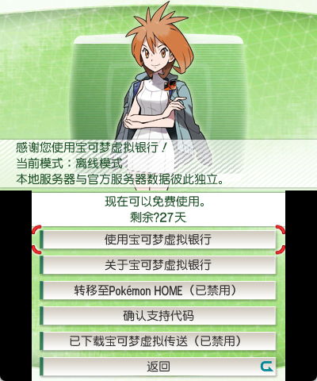

### Bank的使用

#### 离线模式

- 1、在标题界面按 **R** 可以切换模式。
- 2、`离线模式`的基本功能与原版一致，额外添加了部分提示词，且禁用了转移至Home功能和eshop跳转功能。

#### 下载模式

- 1、在标题界面按 **R** 可以切换模式。
- 2、切换到`下载模式`，先在标题选择要使用的目标账户，再下载个人官方银行数据。该账户的现有本地银行会被覆盖，如有需要可先备份原有的bankdata.bin文件。
- 3、下载模式不要求兼容游戏存档；没有可用游戏时，可确认直接下载，完成后返回标题。

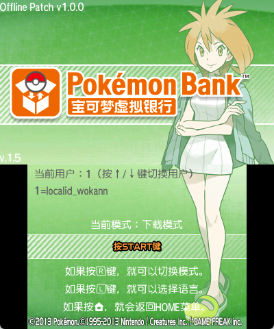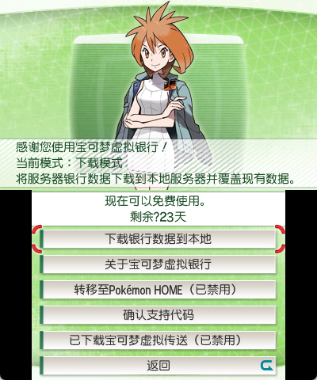

#### 解锁模式

- 1、在标题界面按 **R** 可以切换模式。

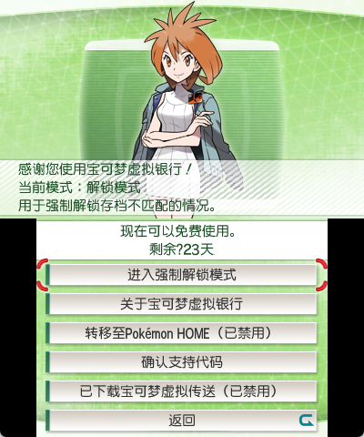

- 2、什么是`解锁模式`，解什么锁？<br>
当玩家在使用银行时，若在保存退出时意外中断，导致服务器数据未能完全走完流程，那么在下一次进入银行时，便会要求玩家使用上次中断时的对应游戏和存档进行重新连接以便将未完成的流程处理完毕。<br>
如果原存档丢失、被替换、推进进度保存其他数据，导致已无法与中断的事务匹配，账户就可能无法通过正常恢复流程继续使用。

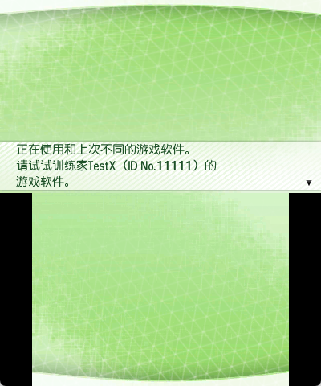<br>
正常情况下，被锁定且找不回对应存档的玩家，需要联系客服按照操作进入解锁界面，并将编号提供给客服，再将客服提供的解锁码输入进界面内以进行解锁。<br>
解锁模式的作用，便是将解锁的组合键明文提示，并在解锁界面直接显示对应的解锁码，以供玩家无需联系客服就能输入解锁码解锁当前账户。

**强制解锁可能导致上一次传输中尚未完成处理的宝可梦丢失。请先确认所有游戏存档均无法匹配官方服务器，再在选择并确认游戏时按住 L＋A＋START 进入强制解锁界面。**

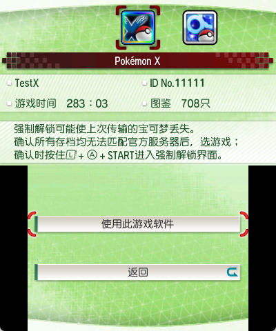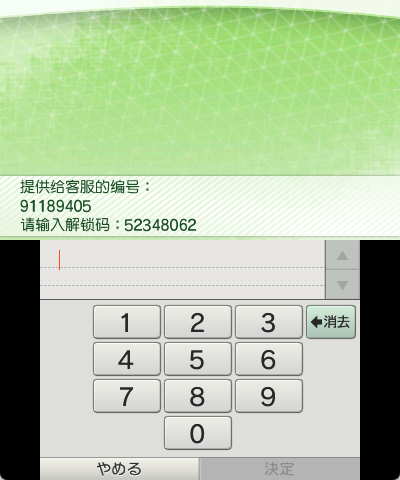

#### 原版模式

- 1、在标题界面按 **R** 可以切换模式。
- 2、`原版模式`沿用官方联网的原版流程，与本地银行数据互相独立。

### Mover的使用

#### 离线模式

- 1、在标题界面按 **R** 可以切换模式。
- 2、`离线模式`的基本功能与原版一致，额外添加了对Gen5数字版本的识别兼容。

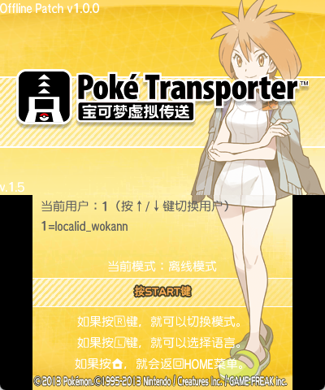

#### 在线模式

- 1、在标题界面按 **R** 可以切换模式。
- 2、`在线模式`沿用官方联网的原版流程，与本地银行数据互相独立，额外添加了对Gen5数字版本的识别兼容。

#### Gen5数字兼容功能

- 1、此功能参考了 zaksabeast 的 [Transporter 重定向补丁](https://github.com/zaksabeast/DreamRadarCartRedirect)，并扩展完善了相关功能。
- 2、仅支持《黑》《白》《黑2》《白2》。将合法转储的 ROM `*.nds` 放入 `SD:/roms/nds/`，同名存档 `*.sav` 放入 `SD:/roms/nds/saves/`；存档无需改成指定文件名。
- 3、支持同时显示4个gen5游戏的存档信息。

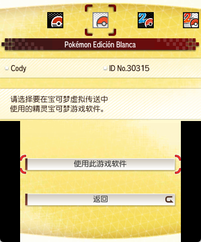

- 4、如果同一个游戏同时存在卡带和数字版本，将优先显示卡带。
- 5、如果同一个游戏同时存在多个语言版本，优先级别将按照`J > O > F > I > D > S > K` `(日>英>法>意>德>西>韩)`的顺序进行识别
- 6、如果同一个游戏的同一个语言版本存在多个副本，将按照程序识别到的第一个拥有有效存档的副本优先。

更加详细说明可见 [Bank 使用说明](bank/README.zh-cn.md)与 [Mover 使用说明](mover/README.zh-cn.md)。

## 进阶用法
### 离线补丁的架构
- 本项目的离线补丁的实现逻辑，是采用本地仿造一个伪服务器的思路。通过这个本地伪造的不涉及联网的简易服务器来响应Bank和mover对原服务器发送的数据和信号。注意，伪服务器的架构实现并不代表与官方的服务器机制相同，仅为民间社区的自定义实现。
- 以下是伪服务器在sd卡上涉及的相关配置和文件结构：
```text
sd:/3ds/Bank/
├── client/
│   ├── client.conf|bak|tmp
│   ├── log/
│   └── users/
│       └── <userID>/
│           └── sav.bin|bak|tmp
└── fakeServers/
    ├── shared/
    │   ├── server.conf|bak|tmp
    │   ├── gifts/
    │   │   ├── gift.conf
    │   │   ├── 01_celebi/
    │   │   ├── 02_johto_starters/
    │   │   ├── 03_regi_trio/
    │   │   ├── 04_mewnium_z/
    │   │   ├── 05_alola_starters/
    │   │   └── 06_ha_apes/
    │   └── mover/
    │       ├── nds/
    │       │   ├── checkPokemon.conf
    │       │   └── checkName.conf
    │       └── vc/
    │           ├── checkPokemon.conf
    │           └── checkName.conf
    └── users/
        └── <userID>/
            ├── user.conf|bak|tmp
            ├── bankdata.bin|bak|tmp
            └── transaction.bin|bak|tmp
```
- `client`：用于登记本地客户端的账户信息，以及对应的sav.bin（这个数据并非存储宝可梦数据的银行数据，而是用于记录与服务器交互的数据，是bank的存档turtle数据的重定向）
- `fakeServers`：伪服务器的核心配置，分为公共配置和个人账户数据，公共配置包括免费使用的时间设定、礼物配信的内容和时限、mover的合法性筛选配置等内容，个人账户数据对应多账户各自存储的银行核心数据及个人区域、余额、有效期等配置数据。

### 创建新账户
- 基础用法部分提及过，bank会在初次使用时，默认为auto模式，该模式会根据主机信息创建默认的初始账户。账户的信息会被存储在 `sd:/3ds/Bank/client/client.conf` 中
```
[global]
activeUser=auto;

[users]
1=nnid_test1;
```
在这个文件中，可以手动在[users]内按顺序添加账户名，名字必须保持前缀为`nnid_xxx`/`pnid_xxx`/`localid_xxx`，后缀内容可以自定义。<br>
同时，也可以将整个`3ds/Bank`文件夹拷贝至其他主机，auto模式下会自动根据当前环境是官服nnid账号，pretendo私服账号或者是模拟器的用户昵称来生成对应的账户。
```
[global]
activeUser=2;

[users]
1=nnid_test1;
2=pnid_test2;
3=localid_test3;
```
添加完成后，无需手动创建对应的账户文件夹，只需要进入bank，在标题界面按上下键切换账户并进行使用，就会创建对应的文件夹。上下切换帐户时，auto选项将始终对应当前主机的默认账户。

- 配置包内包含更加详细的readme.md文档，可阅读此以进一步了解细节内容。

### 免费使用、试用券、虚拟货币功能
- 此数据配置存储于`sd:/3ds/Bank/fakeServers/shared/server.conf`。即便没有拷贝配置包也会生成默认文件及数值。
- 里面记录了官方现有的免费使用的时间区间，以及分发试用券的时间区间，并记录了各个eshop区域的年券价格，以及虚拟充值时一次充值的金额数量，默认1次虚拟充值的金额等于对应货币的年券价格。
- 使用试用券，除了需要将主机条件调整到配置里记录的时间外，还需要使用还没创建过银行数据、没领取过试用券也没购买过年券的账户才能够领取。已经有创建银行数据的账户，即便将时间调整到试用期，也无法触发试用券的领取。
- 你可以自由修改是否开启免费期、试用期，以及调整时间段，也可以修改虚拟年券金额，这些都是本地模拟，与现实金钱无关。
- 每个账户在其各自的`sd:/3ds/Bank/fakeServers/users/<userID>/user.conf`配置文件中，存储该账户的虚拟余额、有效使用期等信息。
```
[ticket]
free_enable=true;
free_periods=2020-02-12..2020-03-12,2023-02-14..2050-12-31;

trial_enable=true;
trial_periods=2013-12-25..2014-02-21;
trial_periods.JPN=2013-12-25..2014-02-21;
trial_periods.USA=2014-02-05..2014-03-14;
……

# shop.$<currency>=<annual_price>,<recharge>; non-negative integers. Balances are in user.conf.
# $NONE uses the custom value 807, the highest Pokedex number supported by Bank.
shop.$NONE=807,807;
shop.$JPY=500,500;
shop.$USD=499,499;
……
```
- 配置包内包含更加详细的readme.md文档，可阅读此以进一步了解细节内容。

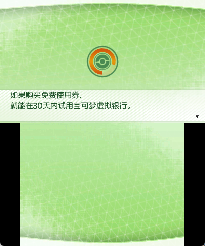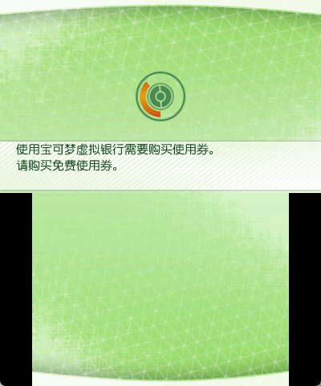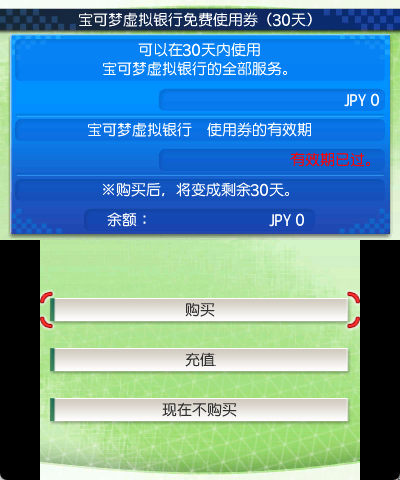

### 神秘礼物功能
- 此功能需要将补丁附带的配置包复制入sd卡指定位置。
- `sd:/3ds/Bank/fakeServers/shared/gifts/gift.conf`中登记了现有的6个银行礼物的基础信息、对应调用的礼物数据路径，以及可配信礼物的时间范围。默认按官方历史的时间设置，也可以自行修改是否启用某个礼物或更改配信的时间范围。
- 支持自定义礼物，支持wc6,pl6,wc7等礼物数据按照模板放入后自定义配置神秘礼物的分发。
```
[global]
enableGift=true;

[gift.01_celebi]
enabled=1;
id=1;
generation=6;
games=XY;
periods=2013-12-25..2014-09-30;
periods.USA=2014-02-05..2014-09-30;
periods.EUR=2014-02-04..2014-09-30;
periods.AUS=2014-02-04..2014-09-30;
file=gifts/01_celebi/celebi.pl6;
```
- 配置包内包含更加详细的readme.md文档，可阅读此以进一步了解细节内容。


### mover合法性筛选
- 此功能需要将补丁附带的配置包复制入sd卡指定位置。
- `sd:/3ds/Bank/fakeServers/shared/mover/`下各分`nds`和`vc`，内部分别配置了`checkPokemon.conf`和`checkName.conf`。
- `checkPokemon.conf`用于存储满足特定条件的宝可梦被允许传送或不被允许传送，这里记录的内容为民间确定的数据，并不代表完全还原了官方的实际规则。
```
[global]
enableCheckPokemon=true;

[rule.151_mew_ot_tid22796]
enabled=1;
action=require;
condition=
    species == 151 &&
    tid == 22796 &&
    (ot == "GF" || ot == "ゲーフリ");
```
- `checkName.conf`用于存储敏感词列表，由于无法获取官方的规则，故此处定为使用nintendo 3DS 11.1.0-34对应的version 18 ngword列表，此为3ds上的最后一版ngword。
- 与神秘礼物相同，你可以自行在配置里添加或删减对应的数据，也可以在开头直接全局禁用合法性筛选。
```
[global]
enableCheckName=true;

[allow_nickname]

[allow_ot]

[ngword]
……
```
- 配置包内包含更加详细的readme.md文档，可阅读此以进一步了解细节内容。

### 账户配置
- 每一个账户均会在`sd:/3ds/Bank/fakeServers/users/<userID>/user.conf`存储一个核心配置，用于记录区域信息、有效期时限、虚拟余额等内容。
- 有效期时限与虚拟余额，跟前文`免费使用、试用券、虚拟货币功能`内容对应
- 区域信息来自于创建该账户时，主机的区域信息。并在第一次设置完成后，不再自动更改区域。
- 区域信息对于Bank的使用影响不大，但对于mover传送vc的使用影响较大。原版情况下，vc通过mover传送到bank时，会根据主机区域信息写入宝可梦信息。由于vc不存在eshop跨区购买的情况，所以一旦出现将转储的美版vc安装在日版主机上，并通过mover传送时，就会由于区域信息的异常被判定为非法.
- 个人账户的区域信息可以通过手动更改对应的地区，来匹配要传送的vc的正确区域位置。
- `sd:/3ds/Bank/fakeServers/users/readme_user.md` 附带了完整的区域组合列表供玩家选取合适的数值。
```
[console]
autoRegion=false;
region=0;
language=0;
country=1;
state=0;

[ticket]
purchased=false;
paid_periods=0000-00-00..0000-00-00;
trial_claimed=false;
annual_count=0;

autoCurrency=true;
currentCurrency=$JPY;
balance.$NONE=0;
balance.$JPY=0;
balance.$USD=0;
……
```
- 配置包内包含更加详细的readme.md文档，可阅读此以进一步了解细节内容。


## 配置与文档

- [SD 目录及文件保护](configTemplate/templateForCopy/Bank/readme_fakeServer.zh-cn.md)
- [用户选择与迁移](configTemplate/templateForCopy/Bank/client/readme_client.zh-cn.md)
- [伪服务器政策与诊断日志](configTemplate/templateForCopy/Bank/fakeServers/shared/readme_server.zh-cn.md)
- [个人地区、币种与使用券](configTemplate/templateForCopy/Bank/fakeServers/users/readme_user.zh-cn.md)
- [礼物配置](configTemplate/templateForCopy/Bank/fakeServers/shared/gifts/readme_gift.zh-cn.md)
- [宝可梦筛选及规则来源](configTemplate/templateForCopy/Bank/fakeServers/shared/mover/readme_checkPokemon.zh-cn.md)
- [姓名词表、白名单及来源](configTemplate/templateForCopy/Bank/fakeServers/shared/mover/readme_checkName.zh-cn.md)
- [银行数据查看器](ViewerForBankdata/README.zh-cn.md)

## 从源码构建

构建使用 GNU Make、Python 3、devkitARM、armips 和 Floating IPS。<br>
原始解密／解压代码、ExHeader 及 RomFS 必须自行从合法持有的软件中提取，本仓库不分发这些输入。

在仓库根目录执行 `make`，会编译并校验 Bank 和 Mover，输出到 `release/`。也可以通过 `make -C bank`、`make -C mover` 分别构建。

- [Bank 构建与实现说明](bank/README.zh-cn.md#独立编译)
- [Mover 构建与实现说明](mover/README.zh-cn.md#独立编译)
- [共用服务与存储](common/README.zh-cn.md)

## 许可证

本项目采用 GNU 通用公共许可证第 3 版或任何后续版本（`GPL-3.0-or-later`），详见 [LICENSE](LICENSE)。

引用的第三方代码、工具、数据及素材保留各自的许可证与版权声明，详见相应文件及说明。本项目的许可证不替代或扩大第三方授权。

## 鸣谢

感谢以下项目提供的工具、数据及公开实现参考：

- [Luma3DS](https://github.com/LumaTeam/Luma3DS)：实机补丁加载、LayeredFS、BPS 及主机地区覆盖接口参考。
- [devkitPro / devkitARM](https://github.com/devkitPro/buildscripts)、[armips](https://github.com/Kingcom/armips) 和 [Floating IPS](https://github.com/Sir-Walrus/Flips)：编译工具链、汇编及 BPS 补丁生成。
- [GodMode9](https://github.com/d0k3/GodMode9)：软件数据提取。
- [DreamRadarCartRedirect](https://github.com/zaksabeast/DreamRadarCartRedirect)：从 NDS 卡带重定向至 SD 存档的方案参考。
- [libctru](https://github.com/devkitPro/libctru)、[citro3d](https://github.com/devkitPro/citro3d)：3DS 系统服务、字库结构与纹理格式参考。
- [Azahar](https://github.com/azahar-emu/azahar) 和 [Nimbus](https://github.com/PretendoNetwork/nimbus)：模拟器加载与系统接口、Nintendo／Pretendo 服务环境识别参考。
- [Magikoopa](https://github.com/RicBent/Magikoopa)：3DS 代码注入及可执行映像扩展参考。
- [3DS-Explorer / DSDecmp](https://github.com/svn2github/3DS-Explorer) 和 [Switch-Toolbox](https://github.com/KillzXGaming/Switch-Toolbox)：LZ11 压缩格式与 CTR 布局格式参考。
- [PKHeX](https://github.com/kwsch/PKHeX) 和 [PokeAPI](https://github.com/PokeAPI/pokeapi)：宝可梦格式、多语言名称、语言／版本及地区数据参考。
- [EventsGallery](https://github.com/projectpokemon/EventsGallery)：礼物配信素材及记录。
- [badword](https://github.com/abcboy101/badword)：Nintendo 3DS 敏感词数据及 NGWord 规则资料。
- [PKMN_GSCHS](https://github.com/TomJinW/PKMN_GSCHS) 和 [pokecrystal_cn](https://github.com/TomJinW/pokecrystal_cn)：韩版金银与美版水晶汉化的字符编码映射。
- [LumaLocaleSwitcher Reworked 汉化版](https://github.com/OasisAkari/LumaLocaleSwitcher_Reworked_zh_hans)：国家和省州编号资料。
- [pret/pokecrystal](https://github.com/pret/pokecrystal)：第二世代奇异蛋配信数据参考。
- [Unicode Character Database](https://www.unicode.org/Public/17.0.0/ucd/ReadMe.txt)：姓名匹配使用的 Unicode 大小写映射数据，授权见 [Unicode 许可证](common/tools/LICENSE.unicode.txt)。

具体数据来源、版本及授权说明见对应的配置文档；各第三方项目保留各自的许可证与版权声明。

## 非官方声明

本项目是独立制作的非官方补丁，与 Nintendo、The Pokemon Company、Creatures Inc. 及 GAME FREAK inc. 没有从属或合作关系，也未获得其赞助、认可或授权。原软件、角色、名称及素材的知识产权归各自权利人所有。本项目用于软件保存、技术研究与互操作性。
